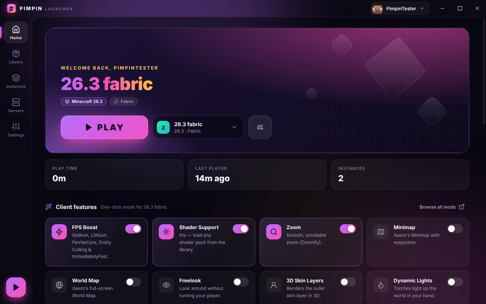

# Pimpin Launcher

A custom Minecraft: Java Edition launcher in the style of Feather and Lunar, with its own UI and a built-in public library of **mods, shaders, resource packs, modpacks and server plugins**. Runs on **Windows 10/11** and **Linux**; macOS should work too but hasn't been tested.



## Features

- **One big PLAY button.** Pimpin downloads the game, libraries, assets and natives itself, plus the Java version each Minecraft release needs (Java 8, 17, 21 or 25). You don't need to install Java.
- **Instances.** Each instance is its own game folder with its own version, mod loader (**Vanilla, Fabric or Quilt**), mods, shaders, worlds, memory and Java settings. It handles old versions like 1.8.9 and the new `26.x` versions.
- **Client features (Feather/Lunar style).** Switch on curated features and the matching mods for your version are installed with their dependencies:
  FPS Boost (Sodium, Lithium, FerriteCore, Entity Culling, ImmediatelyFast), Shader Support (Iris), Zoom, Minimap, World Map, Freelook, 3D Skin Layers, Dynamic Lights, Better Animations, Better HUD, Connected Textures, Background FPS saver and Mod Menu.
  New Fabric/Quilt instances can include **Pimpin Essentials** (FPS Boost, Zoom and Mod Menu) automatically.
- **Public library** powered by [Modrinth](https://modrinth.com):
  - **Mods.** Search, filter to what's compatible, and install with one click. Required dependencies (Fabric API and others) come along automatically.
  - **Shaders.** Install any shader pack. Iris and Sodium are added for you.
  - **Resource packs.**
  - **Modpacks.** Install `.mrpack` modpacks (Fabric/Quilt) as a new ready-to-play instance.
  - **Plugins.** Install them onto a local Paper server.
- **Content manager.** Turn installed mods, shaders and packs on or off, remove them, or check for updates and update them all. Mods you drop into the folder by hand are identified automatically.
- **Local servers.** Create a [Paper](https://papermc.io), [Purpur](https://purpurmc.org) or Vanilla server, install plugins from the library, start/stop/restart it, type console commands, and **Join** with one click (it launches a matching instance and connects to `localhost`).
  - **Starter plugins** when you create a server: EssentialsX, LuckPerms, WorldEdit, Chunky, ViaVersion and Geyser + Floodgate (Bedrock players).
  - **Properties editor** for game mode, difficulty, max players, MOTD, PvP, whitelist, hardcore, view distance, seed and more. Offline accounts get a one-click fix if the server only allows Microsoft accounts.
  - **Players tab** shows who's online, operators, the whitelist and bans, with OP / kick / ban / pardon buttons.
  - **World backups.** Zip the world (even while the server runs) and restore it later.
  - Quick console buttons (save, day, clear weather, TPS, broadcast), command history, your **LAN address** to share with friends, uptime, plugin updates, auto-restart after a crash and custom JVM arguments.
- **Pimpin Client, our own mod (Fabric/Quilt, Minecraft 1.20 – 26.3).** Turn it on in Client features and you get:
  - A HUD with FPS, coordinates, direction, biome, ping, speed, clock and your last death spot; keystrokes with CPS; armour durability. Position, size and colour are up to you.
  - A **minimap**: square or round, north-up or turning with you, five zoom levels, biome-tinted terrain with hill shading, see-through water, other players, mobs (red hostile, green passive), a death marker and a cave view underground and in the Nether. It remembers areas you've explored and scans chunks in the background with a time budget, so it doesn't cost FPS.
  - A **big map**: hold J, scroll to zoom.
  - **Waypoints**: press B to drop one where you stand. They show on the minimap (stuck to the edge when far away) and with their names on the big map; rename, recolour, hide or delete them under Pimpin settings → Minimap → Waypoints. Saved per world/server and dimension.
  - A **Pimpin loading screen** instead of the red Mojang Studios one, at startup and whenever resources reload (can be turned off under General).
  - **Zoom** (hold Z, scroll to adjust, smooth).
  - An **FPS booster**: caps the frame rate while the game is in the background, plus a one-click fast-settings switch that remembers your old settings.
  - A built-in **mod menu** (Right Shift or the "✦ Pimpin" button on the title and pause screens): every mod with its icon, version, authors, description and website, search, and a shortcut to the mods folder.
  - One jar per Minecraft line: 1.20–1.20.1, 1.20.2, 1.20.3–1.20.4, 1.20.5–1.20.6, 1.21–1.21.1, 1.21.2–1.21.3, 1.21.4, 1.21.5, 1.21.6–1.21.8, 1.21.9–1.21.10, 1.21.11, 26.1.x, 26.2 and 26.3. The launcher picks the right one and updates it when the launcher updates.
  - Source in `mod/`: one shared source tree with `//#if MC >= 1.21.6` style lines for version differences (Mojang names everywhere). `cd mod && ./gradlew collect` builds every version (JDK 25) and copies the jars plus `pimpin-client.json` into `resources/mods/`; `./gradlew :1.21.4:runClient` starts a test game.
- **Pimpin Specials: our own resource packs and shaders.**
  - **Pimpin Performance** (16×) and **Pimpin Pretty** (32×): original, hand-pixelled looking textures drawn by the launcher (no Mojang art), built for each instance's Minecraft version (1.8.9 up to 26.3). Blocks and ores, liquids, low fire (Performance), sky, plus **mobs** (zombie, skeleton, creeper, spider, enderman, cow, pig, sheep, chicken, including the 1.21.5+ variants), **nine default player skins** and a **hotbar/HUD** (hearts, food, armour, air, XP bar, buttons; `widgets.png` on 1.8.9–1.20.1).
  - **Pimpin Shaders Lite**: soft shadows, warm light, sky glow, nicer water and waving plants in one cheap pass, for people who want good looks and high FPS.
  - **Pimpin Shaders Ultra**: big soft shadows, coloured light through stained glass, god rays, water reflections, bloom and auto exposure, with Low/Medium/High/Ultra profiles. Both work with Iris (installed for you on Fabric/Quilt) and OptiFine and handle the Nether and End.
  - **Max FPS / Balanced / Max Pretty** combos set everything up in one click (pack + game settings + matching mods; Balanced turns on Shaders Lite, Max Pretty turns on Shaders Ultra).
  - **Game-settings presets** (FPS, Balanced, Pretty) write `options.txt` for you. Export any pack or shader as a `.zip`, or run `npm run packs -- <version>`. Shader sources are generated by `scripts/shaderpacks/gen.py` (`compile_check.py` checks them with glslang).
- **File browser.** Every instance and server has a Files tab: browse its folders, edit configs and `server.properties` in the launcher, rename, delete, make folders, and drag files in from your PC.
- **Accounts.** Sign in with Microsoft (the official Microsoft login window) to play online, or add offline accounts. Login tokens are encrypted with your OS keychain.
- **Worlds & screenshots.** Each instance lists its worlds. Press Play on one to load straight into it (1.20+), or use "Jump back in" on Home. Screenshots appear in a gallery.
- **Crash helper.** If the game crashes, a dialog shows the end of the log, the crash report and plain-English hints (incompatible mods, out of memory, wrong Java, graphics drivers).
- **Updater.** The Windows installer and the AppImage update themselves from GitHub Releases (turn automatic installs off if you like, or join the Beta channel). Portable, `.deb` and macOS copies get an "Update to x.y.z" button that downloads the right file. Release notes are shown before you update, and a "What's new" window after.
- **Made easy.** A first-run setup (sign in, pick a look, get a ready-to-play Max FPS or Max Pretty game), a **command palette** (Ctrl+K) to find any instance, server, page or action, keyboard shortcuts (F1), desktop notifications, a tray icon with quick Play, start with your PC, export/import instances as `.zip`, and "Update all" for the mods in every instance.
- **3D.** Your real skin is drawn as a 3D player on the home screen: drag to spin it, click to wave, and its head follows your mouse. Pick a pose (idle, walk, run, zombie, sit, dance), how it turns, and whether it stands on a glow or a grass block. There's also a title-screen style **3D panorama** (a floating voxel island with trees, water and a square sun), 3D block icons for the sidebar and instances, 3D page transitions and cards that tilt towards the cursor.
- **Make it yours.** One-click theme presets (Pimpin Modern, OG Minecraft, Nether, The End), or mix your own: Modern or **Classic Minecraft** style (stone buttons, dark panels, text shadows), a pixel font, rounded or blocky corners, backgrounds (glow, 3D panorama, dirt, Nether, End, plain), 10 accent colours or your own two, UI size, glass blur, animations, Minecraft-style click sounds, what Home shows and which page the launcher opens on. All block textures are drawn by the launcher itself.
- **Custom UI.** Frameless window, five accent themes, live game console with readable logs, Minecraft news, play-time tracking, and you can duplicate instances.

## Download

Every push to `main` publishes a new release with installers to the public [pimpin-launcher-releases](https://github.com/Nos-and-Stealzers/pimpin-launcher-releases/releases) repo (this source repo is private, so launchers couldn't check it). Installed copies check there and update themselves; the workflow needs the `RELEASES_TOKEN` secret (a token that can write releases to that repo).

| Platform | File |
| --- | --- |
| Windows 10/11 | `PimpinLauncher-Setup-x.y.z.exe` (installer) or `PimpinLauncher-Portable-x.y.z.exe` |
| Linux | `PimpinLauncher-x.y.z-linux-x86_64.AppImage` or `.deb` |

> The Windows build isn't code-signed yet, so SmartScreen may warn you the first time. Click "More info" → "Run anyway".

## Run from source

Requires [Node.js](https://nodejs.org) 20 or newer.

```bash
npm install
npm start          # run the launcher
npm run check      # syntax-check all sources
npm run packs      # write the Pimpin resource packs to dist/packs
npm run dist:win   # build Windows installer + portable exe (run on Windows)
npm run dist:linux # build AppImage + deb
```

## Where things are stored

| OS | Folder |
| --- | --- |
| Windows | `%APPDATA%\.pimpinlauncher` |
| Linux | `~/.local/share/pimpinlauncher` |
| macOS | `~/Library/Application Support/pimpinlauncher` |

Inside that folder, `instances/` and `servers/` hold your game folders, `shared/` holds versions, libraries and assets shared by all instances, and `runtimes/` holds the downloaded Java runtimes. Set the `PIMPIN_ROOT` environment variable to use a different folder.

## How it works

```
src/main/        Electron main process (Node)
  minecraft.js   version resolution, Fabric/Quilt profiles, downloads, natives, launch arguments
  java.js        Java runtimes (Mojang's official runtimes, Adoptium fallback)
  auth.js        Microsoft (msmc) + offline accounts
  modrinth.js    Modrinth API client
  content.js     install/remove/update mods, shaders, packs & plugins, dependency resolution, client features
  instances.js   instances, game process, modpacks
  servers.js     Paper/Purpur/Vanilla servers, properties, players, backups, console
  files.js       file browser for instance & server folders
  packs.js       Pimpin resource packs, options.txt presets
  pack-art.js    procedural textures for the packs (png.js encodes them)
  main.js        window + RPC bridge
src/renderer/    the UI (plain HTML/CSS/JS modules, no framework)
  js/fx3d.js     CSS-3D player model, blocks and card tilt (no WebGL needed)
  js/panorama.js 3D floating-island background
  js/textures.js procedural 16×16 block textures
  js/appearance.js themes, backgrounds, scale and click sounds
  fonts/         Pixelify Sans (SIL Open Font License)
  js/files.js    file browser UI
```

## Not supported yet

- Forge and NeoForge (instances and modpacks). Fabric and Quilt are supported.
- Code signing.
- Auto-update for the portable exe and the `.deb` (download a new copy instead).

Pimpin Launcher is not affiliated with Mojang or Microsoft. Minecraft is a trademark of Mojang Studios.
